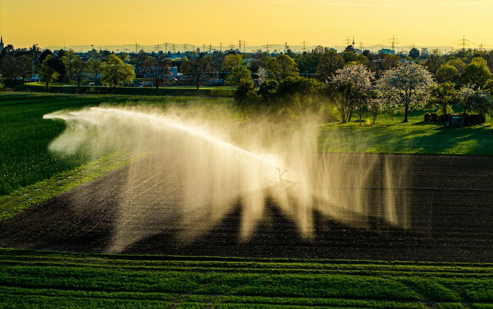

# Rwanda Irrigation Decision Support System

A professional, data-driven Streamlit application for exploring irrigation methods and agricultural water sources across Rwanda's districts. It helps planners, policymakers, researchers, and farmers turn seasonal survey data into practical, climate-resilient irrigation decisions.



*Photo: Bernd Dittrich / Unsplash*

---

## Contents

- [What this app does](#what-this-app-does)
- [Key features](#key-features)
- [Data](#data)
- [Quick start](#quick-start)
- [How to access the app](#how-to-access-the-app)
- [How to use the app](#how-to-use-the-app)
- [Project structure](#project-structure)
- [Configuration](#configuration)
- [Troubleshooting](#troubleshooting)
- [Limitations and responsible use](#limitations-and-responsible-use)
- [Tech stack](#tech-stack)
- [Acknowledgements](#acknowledgements)

---

## What this app does

The Rwanda Irrigation Decision Support System (DSS) analyzes data from the National Institute of Statistics of Rwanda (NISR) Seasonal Agricultural Survey (SAS) 2025. It provides:

- District-level insight into irrigation methods and agricultural water sources.
- Seasonal comparisons across Rwanda's agricultural seasons.
- Data-informed intervention and water-storage recommendations.
- Clear documentation of data sources, methodology, and limitations.

The app is a **planning support tool**. It shows reported patterns and offers rule-based suggestions; it is not a substitute for field assessment, local expertise, or a full feasibility study.

---

## Key features

| Page | What you can do |
| --- | --- |
| **Home** | Get an overview of the platform, key statistics, and links to each tool. |
| **District Explorer** | Select a district and season to compare irrigation methods and water sources using interactive bar charts, donut charts, and breakdown tables. Review data-quality notes for the selected record. |
| **Intervention Planner** | View the dominant irrigation method and primary water source, generate a rule-based recommendation, build a custom strategy, and work through an eight-point feasibility checklist. |
| **About the Data** | Understand the NISR data source, cleaning and analysis methods, limitations, usage guidance, and technical details. |

Additional interface features:

- Consistent branded header and navigation bar on every page.
- Professional green theme with an agriculture-focused hero image.
- Sidebar filters for district and season.
- Responsive layout for desktop, tablet, and mobile.
- Shared footer with navigation and data credits.
- Material icons throughout instead of emoji.

---

## Data

**Source:** National Institute of Statistics of Rwanda (NISR) - Seasonal Agricultural Survey (SAS) 2025.

The application reads two cleaned CSV files from the `Outputs/` folder:

| File | Contents |
| --- | --- |
| `cleaned_irrigation_methods_by_district.csv` | Irrigation methods by district and season: surface, flood, drip, sprinkler, pivot, and traditional techniques. |
| `cleaned_irrigation_water_sources_by_district.csv` | Water sources by district and season: rainwater, water treatment, underground, lake/streams, and water catchment. |

Important data notes:

- Values are reported percentages, not measures of water stress or irrigation need.
- Missing values are preserved as blanks rather than treated as zero.
- Season C has limited data availability and should be interpreted with caution.
- The raw survey workbook is in `data/`; processing scripts are in `src/`.
- Other files in `Outputs/` are supporting analysis outputs and are not required to run the app.

---

## Quick start

### Requirements

- Python 3.10 or newer
- pip
- A modern web browser

### Windows (PowerShell)

```powershell
git clone <repository-url>
cd Rwanda-Irrigation-Decision-Support

python -m venv .venv
.\.venv\Scripts\Activate.ps1

pip install -r requirements.txt
streamlit run app.py
```

If PowerShell blocks the activation script, run this once for the current terminal session:

```powershell
Set-ExecutionPolicy -Scope Process -ExecutionPolicy Bypass
```

### macOS / Linux

```bash
git clone <repository-url>
cd Rwanda-Irrigation-Decision-Support

python3 -m venv .venv
source .venv/bin/activate

pip install -r requirements.txt
streamlit run app.py
```

After starting, Streamlit opens the app at:

```
http://localhost:8501
```

If it does not open automatically, visit that address in your browser.

---

## How to access the app

### 1. Run locally (recommended for development)

```bash
streamlit run app.py
```

Use a different port if 8501 is already in use:

```bash
streamlit run app.py --server.port 8502
```

### 2. Share on your local network

Start the app so other devices on the same network can reach it:

```bash
streamlit run app.py --server.address 0.0.0.0 --server.port 8501
```

Then share your computer's local IP address, for example:

```
http://192.168.1.25:8501
```

Find your IP with `ipconfig` on Windows or `ip addr` / `ifconfig` on macOS and Linux. Allow the port through your firewall if prompted.

### 3. Deploy publicly with Streamlit Community Cloud

1. Push this project to a GitHub repository.
2. Confirm that `app.py`, `requirements.txt`, the `pages/` folder, and both cleaned CSV files in `Outputs/` are committed.
3. Go to [share.streamlit.io](https://share.streamlit.io) and sign in with GitHub.
4. Select **New app**, then choose your repository, branch, and `app.py` as the main file.
5. Click **Deploy**. Streamlit installs `requirements.txt` automatically.

No secrets or API keys are required. The app uses only the bundled CSV files and local assets.

---

## How to use the app

1. **Start on Home.** Review the overview, quick statistics, and platform capabilities.
2. **Open District Explorer.** Choose a district and agricultural season in the sidebar. Review the overview metrics, the irrigation-method bar chart, the water-source donut chart, and the breakdown tables.
3. **Check data quality.** Read the notes for your selection. If data is limited, especially for Season C, compare with another season and interpret cautiously.
4. **Open Intervention Planner.** Select the same or a different district and season. Review the current situation. Choose either the rule-based recommendation or build a custom strategy.
5. **Complete the feasibility checklist.** Confirm water availability, climate data, crop requirements, economic viability, technical capacity, regulatory compliance, community acceptance, and environmental impact before implementation.
6. **Read About the Data.** Use the methodology and limitations sections when presenting or defending a decision.

Navigation is available from the top header on every page and from the footer.

---

## Project structure

```text
Rwanda-Irrigation-Decision-Support/
├── app.py                          # Main application entry point (Home page)
├── ui.py                           # Shared theme, header, navigation, and footer
├── pages/
│   ├── 1_District_Explorer.py      # District and season analysis
│   ├── 2_Intervention_Planner.py   # Recommendations and feasibility checklist
│   └── 3_About_the_Data.py         # Data source, methodology, limitations
├── assets/
│   └── hero_irrigation.jpg         # Agriculture hero image
├── Outputs/
│   ├── cleaned_irrigation_methods_by_district.csv
│   ├── cleaned_irrigation_water_sources_by_district.csv
│   └── ...                         # Supporting analysis outputs
├── data/
│   └── SAS 2025 annual tables      # Raw NISR workbook
├── src/                            # Data extraction, cleaning, validation, visualization scripts
├── .streamlit/
│   └── config.toml                 # Theme and server configuration
├── requirements.txt                # Python dependencies
└── README.md
```

Notes:

- Always run the app from the project root so the `pages/` and `ui.py` imports resolve correctly.
- The `app/` folder contains earlier development copies and is not needed to run the current application.
- Keep the exact CSV file names; the app looks for them in `Outputs/`.

---

## Configuration

The theme and server settings are defined in `.streamlit/config.toml`:

```toml
[theme]
base = "light"
primaryColor = "#16a34a"
backgroundColor = "#f4f7f3"
secondaryBackgroundColor = "#f0fdf4"
textColor = "#1f2d24"
font = "sans serif"

[server]
headless = true
enableXsrfProtection = true

[browser]
gatherUsageStats = false
```

You can change the colors or font there. Restart the app after editing the file.

---

## Troubleshooting

| Problem | Solution |
| --- | --- |
| `streamlit: command not found` | Activate the virtual environment, or run `python -m streamlit run app.py`. |
| Port 8501 already in use | Run `streamlit run app.py --server.port 8502`. |
| "Data files not found" error | Confirm both cleaned CSV files exist in `Outputs/` with the exact names shown above. |
| `ModuleNotFoundError: No module named 'ui'` | Run the app from the project root and do not move `ui.py` or the `pages/` folder. |
| Charts are empty or show warnings | The selected district and season may have missing data. Try another combination. |
| PowerShell will not activate the environment | Run `Set-ExecutionPolicy -Scope Process -ExecutionPolicy Bypass`, then activate again. |
| Dependencies are out of date | Run `pip install --upgrade -r requirements.txt`. |
| App opens but the photo is missing | Confirm `assets/hero_irrigation.jpg` exists and was not renamed. |

---

## Limitations and responsible use

- **Planning support only:** Recommendations are based on reported patterns, not direct measurements of water stress, irrigation demand, or infrastructure condition.
- **Static snapshot:** The data represents a specific survey period and does not show long-term trends.
- **No performance metrics:** Crop yields, water-use efficiency, costs, and intervention effectiveness are not included.
- **Local context is missing:** Soil, topography, socio-economic conditions, and community priorities are not captured.
- **Incomplete records:** Some district-season combinations have missing data; Season C is especially limited.
- **Validation is essential:** Combine the tool's output with field visits, local expertise, stakeholder engagement, and additional data before making investment decisions.

---

## Tech stack

- **Python** - application language
- **Streamlit** - web application framework
- **pandas** - data loading and transformation
- **Plotly** - interactive charts
- **openpyxl** - Excel workbook support
- **HTML and CSS** - shared theme, header, and footer in `ui.py`

---

## Acknowledgements

- **Data:** National Institute of Statistics of Rwanda (NISR), Seasonal Agricultural Survey 2025.
- **Event:** NISR Big Data Hackathon 2026 - Agricultural Productivity Track.
- **Hero photo:** Bernd Dittrich on [Unsplash](https://unsplash.com/photos/a-field-is-being-irrigated-with-sprinklers-sktVzTJcGAs).

---

*Built to support data-driven, climate-resilient agricultural planning in Rwanda.*
